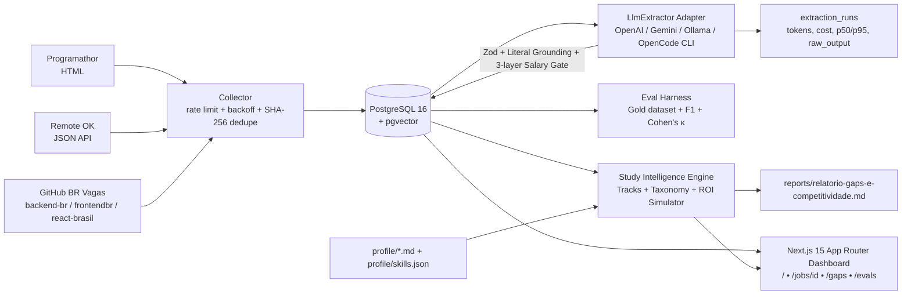

# Job Radar AI

End-to-end AI Engineering & career intelligence platform: collects public software engineering job posts, extracts structured requirements with provider-agnostic LLMs under strict Zod + literal grounding contracts, measures extraction quality with a deterministic evaluation harness, and ranks market study gaps via proficiency-weighted matching, counterfactual ROI simulation, and dynamic competitor benchmarking.

**Status:** All 6 specification blocks (**B1–B6**) plus the **Study Intelligence & Multi-Provider Upgrade** are implemented, tested (**97/97 unit tests**), and validated locally against PostgreSQL 16 + `pgvector` across **94 collected / 53 extracted public jobs**.

---

## Architecture



---

## Real Measured Results (2026-11-19)

Every number below is measured directly from the local PostgreSQL database and recorded in `extraction_runs`, `eval_runs`, and [`reports/relatorio-gaps-e-competitividade.md`](reports/relatorio-gaps-e-competitividade.md).

### 1. Ingestion & Multi-Provider LLM Telemetry

- **Collected:** **94 public jobs** (`28` Programathor, `41` Remote OK, `25` GitHub BR Vagas), **94 distinct SHA-256 description hashes**.
- **Extracted & Grounded:** **53 jobs**, **778 grounded requirements** (`482` distinct raw labels).

| Model / Adapter | Status | Runs | Avg Latency | p50 | p95 | Tokens In | Tokens Out | Cost (USD) |
|---|---|---:|---:|---:|---:|---:|---:|---:|
| `jobradar-qwen` (Ollama local `qwen2.5:7b-instruct`) | `ok` | 22 | 92,464 ms | 84,046 ms | 155,738 ms | 28,059 | 21,322 | $0.00 |
| `opencode/deepseek-v4.1-flash-free` (`OpenCodeCliExtractor`) | `ok` | 33 | 10,679 ms | **10,004 ms** | **18,036 ms** | 441,047 | 26,370 | $0.00 |
| `opencode/deepseek-v4.1-flash-free` | `invalid_json` (caught by Zod) | 1 | 5,182 ms | 5,182 ms | 5,182 ms | 13,838 | 555 | $0.00 |
| `opencode/deepseek-v4.1-flash-free` | `grounding_failed` (caught by verifier) | 1 | 7,388 ms | 7,388 ms | 7,388 ms | 14,870 | 962 | $0.00 |
| `opencode/deepseek-v4.1-flash-free` | `error` (free-tier burst timeouts) | 16 | — | — | — | — | — | $0.00 |

- Swapping from local 7B Qwen to `opencode/deepseek-v4.1-flash-free` behind the `LlmExtractor` interface achieved an **8.4× p50 latency speedup** (`84.0s → 10.0s`) with zero domain changes.
- Every rejection (`invalid_json`, `grounding_failed`, `error`) was recorded in `extraction_runs` with zero partial writes to `jobs` or `job_requirements`.

### 2. Evaluation Harness (`eval_run #1`, Gold `dataset-v1`)

Evaluated against `data/gold/dataset-v1.json` (20 hand-labeled jobs, Pass 1 + blind Pass 2 = 240 labels) under `extract-v2`:

| Check | Gate Type | Target | Actual | Status |
|---|---|---:|---:|---|
| Zero salary false positives | **Hard Gate** | 0 | **0** | **PASS** |
| Valid JSON against Zod schema | **Hard Gate** | ≥ 0.98 | **1.000** | **PASS** |
| Literal grounding (`evidence_span` in body) | **Hard Gate** | ≥ 0.95 | **1.000** | **PASS** |
| Inter-annotator agreement (Cohen's κ, Pass 2) | **Hard Gate** | ≥ 0.80 | **1.000** | **PASS** |
| Seniority accuracy | Quality target | ≥ 0.85 | **1.000** (20/20) | **PASS** |
| Work model accuracy | Quality target | ≥ 0.90 | **1.000** (20/20) | **PASS** |
| Years required (±1 year tolerance) | Quality target | ≥ 0.85 | **1.000** | **PASS** |
| Stack must-have micro F1 | Quality target | ≥ 0.82 | **0.636** (P: 0.489, R: 0.908) | **FAIL** |

> **Engineering transparency:** All 4 hard gates and all single-label classifications passed at 100%. Stack must-have recall is high (90.8%), while precision (48.9%) missed the 0.82 F1 target because raw LLM extraction emitted free-text descriptive phrases beyond the concise catalog. No targets were relaxed post-hoc — `eval_run #1` remains transparently recorded as **REPROVADO**, and downstream gap analysis applies a strict known-taxonomy allowlist (`packages/shared/src/matching/taxonomy.ts`) to prevent generic phrases from polluting study priorities.

### 3. Study Intelligence & Gap Analysis (53 Extracted Jobs → 15 Target-Track Jobs)

Jobs are deterministically segmented by track (`fullstack_ts`, `ai_engineer`, `backend_node_lead` vs `out_of_scope`), excluding **38 out-of-scope posts** (C#/.NET, Java, PHP, SAP, TOTVS, Swift, Flutter, Rust, Game Dev, Intern/Junior, non-tech) and filtering **62 generic non-skill labels** before ranking gaps against the structured proficiency matrix ([`profile/skills.json`](profile/skills.json)).

- **Target-Track Average Weighted Fit:** **62.8%** (`5` High Fit ≥ 75%, `6` Medium Fit, `4` Low Fit)
- **Must-Have Coverage (Production Senior):** **46.6%** (**58.6%** including working knowledge / studying)

#### Top 10 Prioritized Study Gaps (Counterfactual ROI Simulator)

| # | Skill | Horizon | Current Level | Target-Track Demand | Simulated Gain / Affected Job | ROI Score |
|---:|---|---|---|---:|---:|---:|
| 1 | **python** | Quick Win (has base) | Prática / Portfólio | 40.0% (6x, 6 must) | +4.0 pts | **59** |
| 2 | **react** | Quick Win (has base) | Prática / Portfólio | 33.3% (5x, 4 must) | +4.7 pts | **58** |
| 3 | **agentes de ia** | AI Engineer Bet | Gap | 33.3% (5x, 4 must) | +8.1 pts | **44** |
| 4 | **observabilidade** | High ROI | Gap | 33.3% (5x, 3 must) | +8.0 pts | **42** |
| 5 | **machine learning** | AI Engineer Bet | Em Estudo | 13.3% (2x, 2 must) | +9.2 pts | **36** |
| 6 | **kafka** | High ROI | Gap | 26.7% (4x, 3 must) | +5.2 pts | **34** |
| 7 | **system design** | Quick Win (has base) | Prática / Portfólio | 13.3% (2x, 2 must) | +5.5 pts | **31** |
| 8 | **mcp** | AI Engineer Bet | Gap | 20.0% (3x, 3 must) | +7.4 pts | **30** |
| 9 | **mongodb** | High ROI | Gap | 20.0% (3x, 3 must) | +5.5 pts | **29** |
| 10 | **kubernetes** | High ROI | Gap | 20.0% (3x, 2 must) | +6.9 pts | **28** |

#### Highest-Impact Study Clusters

| Cluster | Gap Skills | Track Presence | Avg Track Fit Gain | Jobs → High Fit |
|---|---|---:|---:|---:|
| **IA, LLMs & Agentes** | `agentes de ia`, `mcp`, `langchain`, `langgraph`, `llmops` | 46.7% (7 jobs) | **+7.1 pts** | +1 |
| **Dados & ML** | `machine learning`, `data pipelines`, `airflow`, `dbt`, `pytorch`, `spark`, `tensorflow` | 20.0% (3 jobs) | **+6.2 pts** | +1 |
| **Cloud & Infraestrutura** | `kubernetes`, `aws serverless`, `azure`, `gcp`, `gitlab ci` | 46.7% (7 jobs) | **+3.9 pts** | +0 |
| **Backend & Arquitetura** | `system design`, `fastapi`, `flask`, `ddd` | 33.3% (5 jobs) | **+2.9 pts** | +0 |
| **Observabilidade & Monitoramento** | `observabilidade` | 33.3% (5 jobs) | **+2.7 pts** | +0 |

#### Dynamic Competitor Benchmark (Same 15 Target-Track Jobs)

Calibrated competitor archetypes evaluated by the exact same proficiency-weighted scoring engine on the same jobs:

| Competitor Archetype | João Avg Fit | Competitor Avg Fit | Delta | Where Competitor Leads | Where João Leads |
|---|---:|---:|---:|---|---|
| **Candidato Médio Full Stack TS** | **62.8%** | 33.3% | **+29.5 pts** | `react`, `mongodb`, `playwright`, `next.js` | `llm`, `aws`, `python`, `evals`, `postgresql` |
| **Candidato AI Engineer (Python)** | **62.8%** | 47.8% | **+15.0 pts** | `python`, `agentes de ia`, `observabilidade`, `fastapi`, `flask` | `aws`, `typescript`, `evals`, `react`, `node.js` |
| **Candidato Sênior Backend & Cloud** | **62.8%** | 45.6% | **+17.2 pts** | `observabilidade`, `kafka`, `mongodb`, `kubernetes`, `rabbitmq` | `llm`, `python`, `evals`, `react`, `machine learning` |

---

## Web Dashboard (`apps/web`)

Built with **Next.js 15 (App Router)** + Tailwind CSS, reading live data from PostgreSQL + `profile/skills.json` (`force-dynamic`):

- **`/` (Jobs & Matching):** Track switcher (`Todas as Trilhas-Alvo`, `Full Stack TS`, `AI Engineer`, `Backend Node / Tech Lead`, `Todas`), seniority & work-model filters, weighted fit scores, and 3-state badges (`✓ produção`, `◐ parcial`, `✗ gap`).
- **`/jobs/[id]` (Job Detail):** Verified 3-layer salary grounding status, normalized must/nice requirements paired with profile evidence and literal `evidence_span` quotes from the job post, and tailored interview preparation.
- **`/gaps` (Study & Positioning Intelligence):** Interactive track tabs, cluster unlock simulator, ROI-ordered study priority list with expandable literal job evidence drill-downs, 4-quadrant technical matrix (Core Advantages, Quick Wins / Depth Gaps, Real Technical Gaps, Moats), dynamic competitor benchmark cards, separated soft skills, and transparent out-of-scope audit list.
- **`/evals` (AI Observability):** Live view of `eval_runs` from PostgreSQL with hard gates, quality targets, Cohen's κ, latency p50/p95, and transparent diagnostics.

---

## Repository Layout

| Path | Responsibility |
|---|---|
| `packages/shared` | Strict TS domain: requirement taxonomy, Zod extraction contract, literal grounding, eval metrics & gates, markdown chunker, track classifier, study intelligence ROI engine, competitor archetypes |
| `apps/worker` | Collectors (`programathor`, `remoteok`, `github`), rate-limited HTTP client, LLM adapters (`OpenAICompatibleExtractor`, `OpenCodeCliExtractor`), transactional extraction pipeline, pgvector profile sync, eval CLI, report generator |
| `apps/web` | Next.js 15 App Router dashboard (`/`, `/jobs/[id]`, `/gaps`, `/evals`) |
| `db/migrations` | Versioned PostgreSQL 16 + `pgvector` schema with salary consistency check constraints and HNSW indexes |
| `profile/` | Versioned candidate markdown (`experiencia.md`, `competencias.md`, `projetos.md`) and structured proficiency matrix (`skills.json`) |
| `data/gold/` | Hand-labeled gold evaluation dataset (`dataset-v1.json`, Pass 1 + blind Pass 2) |
| `docs/` | Annotation guide (`docs/guia-anotacao.md`) and technical decision log (`docs/decisoes-tecnicas.md`) |
| `reports/` | Generated markdown report (`reports/relatorio-gaps-e-competitividade.md`) |

---

## Quickstart

Requirements: **Node 22+**, **pnpm 11+**, **Docker**.

```bash
docker compose up -d
cp .env.example .env
pnpm install
pnpm db:migrate
pnpm db:seed
pnpm profile:sync
```

### Collect & Extract Jobs

```bash
# 1. Collect from public sources (rate-limited, idempotent, SHA-256 deduped)
pnpm collect --source programathor --limit 60
pnpm collect --source remoteok --limit 35
pnpm collect --source github --limit 30

# 2. Extract with OpenCode CLI (free tier, ~10s p50)
LLM_PROVIDER=opencode-cli LLM_MODEL=opencode/deepseek-v4.1-flash-free \
  pnpm extract --source all --limit 50

# Or extract with any OpenAI-compatible provider (OpenAI, Gemini, Ollama)
pnpm extract --source programathor --limit 20
```

### Evaluate, Generate Study Report & Launch Dashboard

```bash
pnpm eval:seed      # Seed gold dataset-v1 into Postgres
pnpm eval           # Run deterministic eval harness and persist eval_run
pnpm match:report   # Compute study ROI + competitor benchmark & update reports/
pnpm web:dev        # Start Next.js dashboard on http://localhost:3000
```

### Quality Checks

```bash
pnpm lint           # ESLint
pnpm typecheck      # TypeScript strict (noUncheckedIndexedAccess, zero any in domain)
pnpm test           # 97 Vitest unit tests across shared & worker
pnpm build          # Full workspace production build
```

---

## Engineering Guardrails & Non-Goals

- **3-layer salary invariant:** Zod schema + literal amount grounding + PostgreSQL `CHECK` constraints (`jobs_salary_consistent`, `jobs_salary_range`) ensure zero invented salary ranges.
- **Prompt injection boundary:** Untrusted external job descriptions are explicitly delimited and post-validated; every extracted requirement must cite a literal `evidence_span` from the normalized description.
- **Respectful public collection:** 1 req/s per host, identified `User-Agent`, exponential backoff with `Retry-After` handling, no raw HTML persistence, no recruiter PII.
- **Explicit non-goals:** No LinkedIn scraping or login automation, no automated job applications, no salary prediction when unpublished, no multi-tenant auth/billing, and no population-wide claims beyond the recorded sample size.

See [`docs/decisoes-tecnicas.md`](docs/decisoes-tecnicas.md) (D1–D8) and [`docs/guia-anotacao.md`](docs/guia-anotacao.md) for full technical decisions and labeling methodology.
