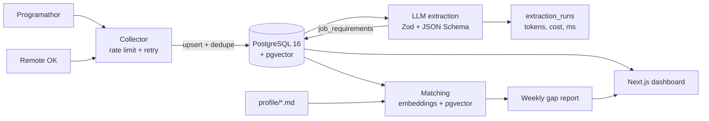
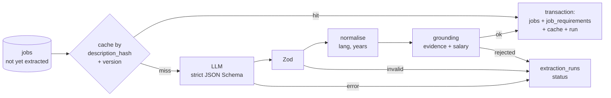

# Job Radar AI

Weekly job triage for one senior engineer: collect public job posts, extract structured requirements with an LLM, rank them against a versioned profile, and report the gaps — with every number backed by a recorded evaluation run.

Status: block **B1 (ingestion and database)** implemented and validated locally. LLM extraction (B2), labelling (B3), matching (B4), dashboard (B5) and publication hardening (B6) are not built yet.

## What exists today

| Piece | State |
|---|---|
| pnpm monorepo, TypeScript strict (`noUncheckedIndexedAccess`) | done |
| Postgres 16 + pgvector schema and versioned migration | done |
| Requirement taxonomy with alias normalisation | done |
| Zod contract for LLM extraction, grounding and salary gate | done, unit-tested |
| Collectors: Programathor (HTML), Remote OK (public JSON API) | done, fixture-tested |
| Dedupe by `(source, source_job_id)` and by description hash | done |
| Rate limit per host, retry with backoff, `Retry-After` on 429 | done |
| CLI collection and requirement seed | done |
| LLM extractor adapter (OpenAI-compatible: OpenAI, Gemini, Ollama) | done |
| Versioned prompt, strict JSON-Schema output, Zod validation, grounding | done |
| Deterministic normalisation (language by body, `years_required` from requirement years) | done |
| Extraction CLI with content cache and transactional persistence | done |
| Annotation guide for gold labeling (`docs/guia-anotacao.md`) | done |
| Evaluation harness (F1 micro/macro, Cohen's $\kappa$, hard gates, DB persistence) | done |
| Evaluation CLI (`pnpm eval:seed`, `pnpm eval`) and versioned dataset | done |
| Profile markdown versioned in `profile/*.md` | done |
| Embedding adapter (1536d) and pgvector profile chunk sync (`pnpm profile:sync`) | done |
| Matching engine, competitor benchmark and market gap report (`pnpm match:report`) | done |
| CI: lint, typecheck, tests, migration smoke, salary-gate check | done |
| Next.js dashboard (B5) | not started |


Observed in the local validation run (2026-11-19): 30 jobs stored — 20 from Programathor and 10 from Remote OK — with 30 distinct description hashes. These are sample counts, not performance claims.

## Architecture



## Quickstart

Requirements: Node 22+, pnpm 11, Docker.

```bash
docker compose up -d
cp .env.example .env
pnpm install
pnpm db:migrate
pnpm db:seed
pnpm collect --source programathor --limit 20
pnpm collect --source remoteok --limit 10
pnpm extract --source programathor --limit 20
```

`pnpm extract` needs an OpenAI-compatible endpoint; see [`.env.example`](.env.example) for OpenAI, Gemini and a local Ollama block. For a local model:

```bash
ollama pull qwen2.5:7b-instruct
printf 'FROM qwen2.5:7b-instruct\nPARAMETER num_ctx 16384\nPARAMETER temperature 0\n' > Modelfile
ollama create jobradar-qwen -f Modelfile
```

The database is exposed on `localhost:55432` (Postgres) and Redis on `localhost:56379`.

## Commands

```bash
pnpm lint
pnpm typecheck
pnpm test
pnpm db:migrate
pnpm db:reset --yes   # local database only
pnpm db:seed
pnpm collect --source programathor --limit 20
pnpm collect --source remoteok --limit 10 --dry-run
pnpm extract --source programathor --limit 20
pnpm extract --source programathor --limit 5 --dry-run
pnpm extract --source programathor --limit 20 --force   # re-extracts even if the version matches
```

## Collection rules

- Only public boards with structured or server-rendered listings: Programathor and Remote OK for now.
- One request per second per host, identified `User-Agent`, retry with backoff and `Retry-After` support.
- LinkedIn is out of scope: no scraping, no automation, no login.
- No personal data from recruiters; only job fields. Raw HTML is not persisted.
- A source failure does not abort the batch already collected; the CLI prints a summary with the error.

## Extraction contract

`packages/shared` holds the contract that the LLM output must satisfy before anything is written:

- Zod schema with closed enums for seniority, work model, language, currency and salary period.
- `salary.published = true` requires `min` or `max`, a currency and a known period; otherwise every salary field must be `null`.
- Every requirement needs an `evidence_span` that appears literally in the normalised description; requirements without it are dropped and counted.
- A published salary whose amounts do not appear in the description rejects the whole extraction. A wrong salary is worse than a missing one.
- Requirement labels are canonicalised against the taxonomy. A label outside it is resolved from the skills named inside its own evidence span (up to three); with none, the requirement stays as a free-text skill with `known = false`, never dropped silently.
- Dropping individual requirements does not fail the job; the count goes to the run summary, and the issues are stored in `extraction_runs.raw_output` when the whole extraction is rejected.

`extraction_runs` records model, prompt version, schema version, status, tokens, cost, latency and `raw_output`, including failures.

## Extraction pipeline



- `apps/worker/src/extract.ts` is the CLI: `--source`, `--limit`, `--dry-run`, `--force`.
- Every model call is one row in `extraction_runs` with `status = ok | invalid_json | grounding_failed | error`. A rejected extraction never writes derived fields to `jobs`.
- An `ok` run updates `jobs` (seniority, work model, language, years, salary, `extractor_version`), replaces `job_requirements` and upserts `extraction_cache` in the same transaction, so a crash cannot leave a half-extracted job.
- Cache hits re-run normalisation and grounding against the stored payload, so a stricter grounding rule does not require a new LLM call.
- The CLI prints a JSON summary: processed, ok, cache hits, invalid JSON, grounding failures, errors, dropped requirements, tokens in/out, cost and latency p50/p95.

`packages/shared/src/extraction/prompt.ts` holds the versioned prompt. Bumping `PROMPT_VERSION` invalidates the cache by design; the current version is `extract-v2`, which requires 1–4 word requirement labels and forbids inferring the work model from the title or the company.

## Evaluation harness (B3)

The evaluation harness measures whether the extraction pipeline meets the production criteria on real, hand-labeled data:

- **Annotation guide:** [`docs/guia-anotacao.md`](docs/guia-anotacao.md) defines objective, reproducible criteria for `seniority`, `work_model`, `salary_published`, `years`, `stack_must` and `stack_nice`.
- **Dataset:** versioned gold dataset in `data/gold/dataset-v1.json` with pass 1 (primary annotation) and pass 2 (blind re-annotation sample for inter-annotator agreement).
- **Commands:**
  ```bash
  pnpm eval:seed   # loads data/gold/dataset-v1.json into the database 'labels' table
  pnpm eval        # runs evaluation against jobs and job_requirements, persists eval_runs
  ```

### Real measured results (`eval_run` #1, 2026-11-19)

Evaluated against `dataset-v1` (20 jobs, pass 1 + blind pass 2) under extractor `extract-v2` (`jobradar-qwen`):

| Check | Gate type | Target | Actual | Status |
|---|---|---|---|---|
| Zero salary false positives | Hard gate | 0 | 0 | **PASS** |
| Valid JSON against Zod schema | Hard gate | $\ge 0.98$ | 1.000 | **PASS** |
| Literal grounding in description | Hard gate | $\ge 0.95$ | 1.000 | **PASS** |
| Inter-annotator agreement (Cohen's $\kappa$) | Hard gate | $\ge 0.80$ | 1.000 | **PASS** |
| Seniority accuracy | Quality target | $\ge 0.85$ | 1.000 (20/20) | **PASS** |
| Work model accuracy | Quality target | $\ge 0.90$ | 1.000 (20/20) | **PASS** |
| Years accuracy ($\pm 1$ year tol.) | Quality target | $\ge 0.85$ | 1.000 | **PASS** |
| Stack must-have micro F1 | Quality target | $\ge 0.82$ | 0.636 (P: 0.489, R: 0.908) | **FAIL** |

**Diagnosis:** Hard gates and single-label classifications passed 100%. Stack must-have recall is high (90.8%), but precision is 48.9% because the local model extracted descriptive phrases (e.g. "ciclo de vida do flutter", "experiencia em aplicativos complexos") beyond the catalog. In accordance with §5.4, the status is transparently reported as **REPROVADO** until prompt/extractor tuning.

## Matching and Gap Analysis (B4)

The matching engine connects hand-curated candidate profile markdown documents with market demand:

- **Candidate profile:** versioned in [`profile/`](profile/) (`experiencia.md`, `competencias.md`, `projetos.md`).
- **Chunking & Embeddings:** chunks stored in PostgreSQL with 1536-dimensional vectors via pgvector HNSW indexing.
- **Commands:**
  ```bash
  pnpm profile:sync   # chunks profile/*.md and generates embeddings in profile_chunks
  pnpm match:report   # evaluates fit, benchmarks against market competitors, and writes gap report
  ```
- **Generated report:** [`reports/relatorio-gaps-e-competitividade.md`](reports/relatorio-gaps-e-competitividade.md) with:
  - 2x2 Competitiveness Matrix (Core Advantages vs Strategic Gaps vs AI Moats).
  - Benchmark comparison between João, average Full Stack candidates and junior AI wrapper candidates.
  - Granular job ranking with cited profile excerpts and missing requirements.

## Decisions

See [`docs/decisoes-tecnicas.md`](docs/decisoes-tecnicas.md) for the closed open questions (embedding dimension, salary invariant, dedupe, `scrappingjob` inventory, which layer writes derived columns).

## What is not verified yet

- Next.js web dashboard with `/evals` and job list (B5).
- Collection depends on Programathor markup; only the two saved fixtures cover it.
- Remote OK terms require attribution and a link back when the API data is displayed.

## Non-goals

- Automatic application, forms, or messages to recruiters.
- LinkedIn collection or automation.
- Multi-user, authentication, billing.
- Salary prediction for posts without a published range.
- Market-wide claims from a 100-job sample.
