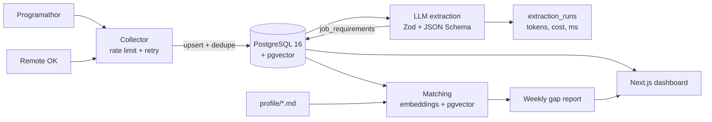

# Job Radar AI

Weekly job triage for one senior engineer: collect public job posts, extract structured requirements with an LLM, rank them against a versioned profile, and report the gaps — with every number backed by a recorded evaluation run.

Status: block **B1 (ingestion and database)** implemented and validated locally. LLM extraction (B2), labelling (B3), matching (B4), dashboard (B5) and publication hardening (B6) are not built yet.

## What exists today

| Piece | State |
|---|---|
| pnpm monorepo, TypeScript strict (`noUncheckedIndexedAccess`) | done |
| Postgres 16 + pgvector schema and versioned migration | done |
| Requirement taxonomy with alias normalisation | done |
| Zod contract for LLM extraction, grounding and salary gate | done, unit-tested |
| Collectors: Programathor (HTML), Remote OK (public JSON API) | done, fixture-tested |
| Dedupe by `(source, source_job_id)` and by description hash | done |
| Rate limit per host, retry with backoff, `Retry-After` on 429 | done |
| CLI collection and requirement seed | done |
| CI: lint, typecheck, tests, migration smoke, salary-gate check | done |
| LLM extractor, eval harness, matching, Next.js dashboard | not started |

Observed in the local validation run (2026-11-19): 30 jobs stored — 20 from Programathor and 10 from Remote OK — with 30 distinct description hashes. These are sample counts, not performance claims.

## Architecture



## Quickstart

Requirements: Node 22+, pnpm 11, Docker.

```bash
docker compose up -d
cp .env.example .env
pnpm install
pnpm db:migrate
pnpm db:seed
pnpm collect --source programathor --limit 20
pnpm collect --source remoteok --limit 10
```

The database is exposed on `localhost:55432` (Postgres) and Redis on `localhost:56379`.

## Commands

```bash
pnpm lint
pnpm typecheck
pnpm test
pnpm db:migrate
pnpm db:reset --yes   # local database only
pnpm db:seed
pnpm collect --source programathor --limit 20
pnpm collect --source remoteok --limit 10 --dry-run
```

## Collection rules

- Only public boards with structured or server-rendered listings: Programathor and Remote OK for now.
- One request per second per host, identified `User-Agent`, retry with backoff and `Retry-After` support.
- LinkedIn is out of scope: no scraping, no automation, no login.
- No personal data from recruiters; only job fields. Raw HTML is not persisted.
- A source failure does not abort the batch already collected; the CLI prints a summary with the error.

## Extraction contract

`packages/shared` holds the contract that the LLM output must satisfy before anything is written:

- Zod schema with closed enums for seniority, work model, language, currency and salary period.
- `salary.published = true` requires `min` or `max`, a currency and a known period; otherwise every salary field must be `null`.
- Every requirement needs an `evidence_span` that appears literally in the normalised description; requirements without it are dropped and counted.
- A published salary whose amounts do not appear in the description rejects the whole extraction. A wrong salary is worse than a missing one.

`extraction_runs` records model, prompt version, schema version, status, tokens, cost, latency and `raw_output`, including failures.

## Decisions

See [`docs/decisoes-tecnicas.md`](docs/decisoes-tecnicas.md) for the closed open questions (embedding dimension, salary invariant, dedupe, `scrappingjob` inventory, which layer writes derived columns).

## What is not verified yet

- No LLM call has run: cost, latency and extraction quality are unmeasured.
- No labelled dataset, no precision/recall/F1, no evaluation run.
- Collection depends on Programathor markup; only the two saved fixtures cover it.
- Remote OK terms require attribution and a link back when the API data is displayed.

## Non-goals

- Automatic application, forms, or messages to recruiters.
- LinkedIn collection or automation.
- Multi-user, authentication, billing.
- Salary prediction for posts without a published range.
- Market-wide claims from a 100-job sample.
